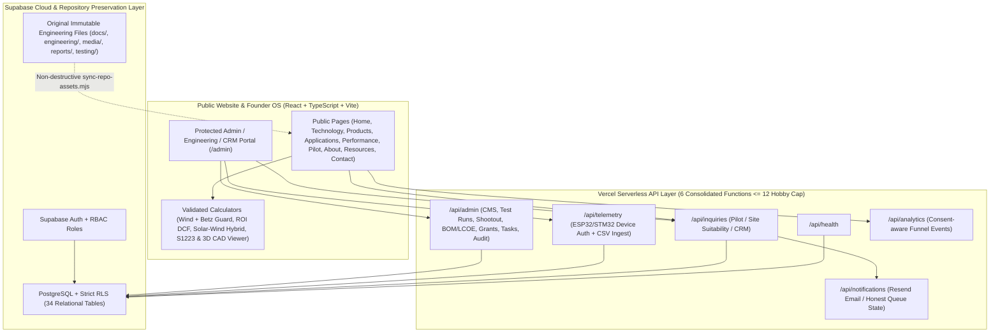

# PAWAN SHAKTI — Technical Architecture Specification

**Repository:** `koyaneni-yaswanth/low-speed-wind-turbine`  
**Branch:** `feature/pawan-shakti-platform`  
**Target Stack:** React 19 + TypeScript + Vite + Tailwind CSS + Three.js + Vercel Serverless + Supabase (PostgreSQL / Auth / Storage / RLS)

---

## 1. High-Level System Architecture

---

## 2. Repository Preservation & Build Asset Pipeline

1. **Zero Deletion / Zero Mutation Rule:** All original files under `docs/`, `engineering/`, `intellectual-property/`, `media/`, `reports/`, `team/`, and `testing/` remain intact in Git.
2. **Public Asset Sync (`scripts/sync-repo-assets.mjs`):**
   - Copies only public-safe approved assets (`media/*`, `engineering/airfoil/S1223.dat`, `engineering/cad/stl-and-3mf/*.{stl,3mf}`, `engineering/drawings/*.pdf`, public `testing/raw-data/sample-sensor-log-template.csv`) into `public/repo-assets/` during `predev`/`prebuild`.
   - Explicitly **never copies** sensitive `.docx` internal agreements or confidential files (`Draft Pre - Incubation Agreement`, unredacted PII).
   - Emits `src/generated/assetManifest.json` with verified byte sizes, formats, STL/3MF vertex/triangle counts, and license tags.

---

## 3. Consolidated Backend API Contract (`api/` — 6 Endpoints)

Vercel Hobby allows up to 12 functions; we keep the API footprint compact with shared helpers under `api/_lib/`:

| Endpoint | Methods | Auth & Security | Purpose |
| :--- | :--- | :--- | :--- |
| `/api/health` | `GET` | Public safe summary (zero secret leakage) | Reports Supabase connectivity, env configuration flags (`configured: boolean`), and schema health |
| `/api/inquiries` | `POST`, `GET`, `PATCH` | `POST`: public Zod-validated + honeypot + rate limit; `GET/PATCH`: authenticated `founder_super_admin` / `crm_admin` | Pilot applications, Site Assessments, Contact forms (`PS-PILOT-YYYYMMDD-XXXX`), 17-stage CRM updates, lead activities & audit log |
| `/api/telemetry` | `POST`, `GET` | `POST`: either per-device `X-Device-Key` + HMAC signature + replay timestamp guard OR authenticated `engineering_admin`; `GET`: public curated test summaries vs full authenticated series | Device ingestion (19 fields, separate `device_timestamp` & `ingested_at`, `sequence_no` idempotency) + CSV batch upload + Betz validation |
| `/api/admin` | `GET`, `POST`, `PATCH`, `DELETE` | Authenticated Supabase JWT + per-action RBAC (`team_member` blocked from financial/CRM PII) | Option A/B Shootout scorecards, Turbines, Test Runs, Project Tasks & editable 30/60/90 roadmap, BOM/Financial scenarios, LCOE settings, Grants, Monthly PDF snapshots, Documents, Resources |
| `/api/analytics` | `POST`, `GET` | `POST`: opt-in anonymous event counters (zero PII); `GET`: `founder_super_admin` / `crm_admin` | Tracks engagement & funnel conversion (`page_view`, `calculator_used`, `pilot_form_start`, `pilot_form_submit`, `resource_download`) |
| `/api/notifications` | `GET`, `POST` | Authenticated admin or server internal call | Email delivery queue (`Pending`, `Sent`, `Failed`, `Retrying`); integrates Resend API if server env present; returns honest `queued_provider_unconfigured` if unset |

### Hardware & Device Ingestion Contract (`/api/telemetry`)
- **Authentication:** Device sends `X-Device-Id`, `X-Device-Timestamp` (epoch seconds, max $\pm 300\text{ s}$ drift), `X-Device-Nonce` / `sequence_no`, and `X-Device-Signature` (`HMAC-SHA256(device_secret_hash, "${ts}.${nonce}.${rawBody}")`). Server checks hashed secret in `devices` table (never exposed to frontend!).
- **Idempotency:** Unique index on `(device_id, device_timestamp, sequence_no)` rejects replay and deduplicates retries cleanly.
- **Range & Physics Sanity Guard:** Validates negative wind speed, impossible voltage/current spikes, flags Betz violation ($C_p > 0.593$) in `data_quality_status` without silently dropping rows.
- **Hardware Safety Firewall:** Website & public APIs expose **monitoring readback ONLY** — zero endpoints exist to command turbine emergency braking, furling, or startup unless an independently reviewed safety controller explicitly authorizes one.

---

## 4. Database Architecture & Offline Integrity

- **Relational Migrations:** `supabase/migrations/001_pawan_shakti_platform.sql` + `supabase/migrations/002_pawan_shakti_hardening_and_completeness.sql` establish 36 relational tables (including `device_errors`), UUID primary keys, `updated_at` triggers, role-escalation guards, and strict RLS policies across every table.
- **API Hardening Update (`11 Nov 2026`):** `api/_lib/db.ts` fails closed to `'public_visitor'`, provides safe `parseJsonBody()` (`400` on malformed JSON), `escapeHtml()` email sanitization, sliding-window rate limiting (`429`), device registration/revocation (`POST /api/telemetry`), and strict `draft -> running -> completed -> reviewed -> rejected` workflow checks.
- **Honest Offline / Unconfigured Behavior:**
  - When `VITE_SUPABASE_URL` / `VITE_SUPABASE_ANON_KEY` or server `SUPABASE_SERVICE_ROLE_KEY` are missing, public informational views, CAD/Airfoil viewers, and local physics/financial calculators work seamlessly with clear **[UNCONFIGURED CLOUD STORAGE — LOCAL READ-ONLY MODE]** notices.
  - Database write actions (Pilot submission, Telemetry upload, CRM edits, Auth) **never fake success** — they invoke real API endpoints which honestly return HTTP `503` diagnostic state until live Supabase credentials are configured.
